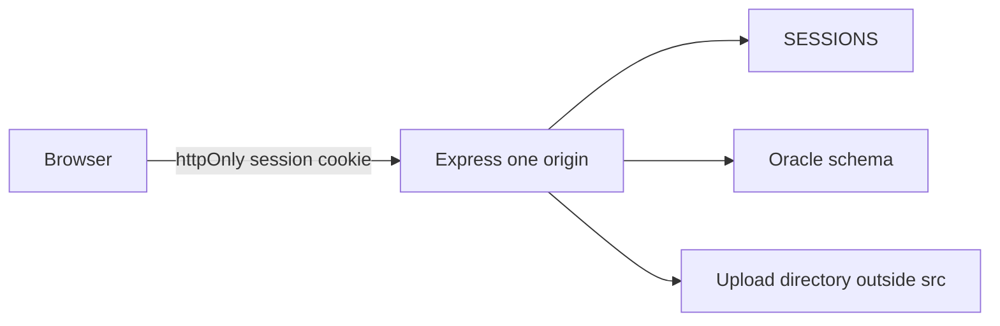

# Architecture Proposal — Cuisine Connect

| | |
|---|---|
| Date | 2026-11-10 |
| Status | Approved for implementation on 2026-11-10. Ticket order is ENG-001 through ENG-008. |
| Direction | Privately deployable product. Chosen after the Phase 1 audit. |
| Baseline | [REPOSITORY_AUDIT.md](REPOSITORY_AUDIT.md) |
| Constraint | Same product, same Oracle schema, current SvelteKit UI. No microservices, no database replacement, no framework rewrite, no visual redesign in this program. |

This document is the approved target state. Implementation follows [ROADMAP.md](ROADMAP.md). The three migration choices are recorded in [DECISIONS.md](DECISIONS.md): the schema may be rebuilt, passwords may be reset, and account deletion becomes a disable.

---

## 1. Product and engineering vision

Cuisine Connect stays a social and food-ordering application for three public roles — customer (`C`), restaurant (`R`), and foodie page (`P`) — plus a real administrator. People register, post, react, comment, share, review, follow restaurants, connect to pages, message, reserve, and order. Restaurants manage a menu and move orders. An administrator can read the activity log and the global lists.

The engineering goal is a system one person can run on a private machine or a single host:

- One Node process serves the API and, in a private deployment, the built UI.
- Oracle remains the system of record. The relational model, bind variables, triggers, and the ERD stay.
- The server knows who is calling. The browser cannot choose another user's id and have a write succeed.
- A new developer can create the schema from ordered scripts, start the app with an environment file, and run a small test set.
- Secrets, uploads, and `node_modules` stay out of Git.

The course design is the asset. The work is to make that design trustworthy, not to replace it with a different architecture.

---

## 2. Current-state assessment

The audit is the description of the system as it exists. The facts that drive this proposal:

- [backend/server.js](../backend/server.js) is the live API: about 4,100 lines, 92 `POST` routes, one Oracle connection per call, `autoCommit: true`. [server.js](../server.js) is a stale second copy with the same credentials.
- The browser writes `username`, `userid`, and `usertype` with `js-cookie` after `CHECK_PASS`. Later requests send those values in JSON. No route reads a session.
- Administrator access is the literal pair checked in [frontend/src/routes/login/+page.svelte](../frontend/src/routes/login/+page.svelte). There is no admin row. The check does not return, so login continues into `CHECK_PASS`.
- Passwords are `ORA_HASH` in `CHECK_PASS` ([functions.sql](../functions.sql)). `USERS.PASSWORD` is `VARCHAR2(100)`. `SELECT *` returns that column to the client. `updatepassword` logs the new plaintext and does not check the old password on the server.
- Database credentials are hardcoded in both server files and printed in [README.md](../README.md). The repository is public. Those credentials are disclosed.
- [create table.sql](../create%20table.sql) defines 20 tables and no sequences. Sequences live in [ebnquery.sql](../ebnquery.sql). A README-ordered install fails on the first `NEXTVAL`.
- Registration, friend accept, and review-plus-rating commit across separate connections. `addnewpost` inserts, then `SELECT MAX(POST_ID)`.
- There are no tests, no CI, no `.gitignore`, and no environment-based configuration.
- The UI is client-rendered SvelteKit. There are no `+page.server` or `+layout.server` modules. [frontend/vite.config.js](../frontend/vite.config.js) has no dev proxy. [frontend/svelte.config.js](../frontend/svelte.config.js) uses `adapter-auto`. Pages call `http://localhost:3001` directly, mostly from [frontend/src/functions.js](../frontend/src/functions.js).

What remains true and should not be "fixed" by deletion: subtype tables, foreign keys with `ON DELETE CASCADE` from `USERS` downward, check constraints already present, triggers for counts and `ADMIN_LOG`, the customer timeline query, the nearby-restaurant sort, and the review-to-rating update.

---

## 3. Target architecture



### 3.1 Runtime shape

Development:

- Vite serves the UI on port 5173 and proxies `/api` and `/uploads` to the API. The browser talks only to Vite, so the session cookie is first-party.
- The API listens on port 3001 and is not called by absolute URL from page code.

Private deployment:

- `npm run build` produces a static SvelteKit client.
- Express serves that build and the API on one port. One origin. No public CORS allowlist.
- Oracle runs on the same machine or on a host reachable only from that machine.

This split exists because the page is on port 5173 and the API is on port 3001 today. A `SameSite=Lax` cookie is not sent on a cross-origin `fetch` from 5173 to 3001. `SameSite=None` requires `Secure`, which means HTTPS during ordinary local development. A proxy in development and one process in deployment removes that problem. The UI stays a client of the API. SvelteKit does not become a second data layer.

### 3.2 Request flow

1. `POST /api/login` checks the password in Node, confirms `ACTIVE_STATUS = 'A'`, inserts a row in `SESSIONS`, and sets an httpOnly cookie. The cookie value is a random session id. It is not the user id and not the password.
2. Later requests send the cookie. Middleware loads the session and attaches the actor: `userId`, `userType`, and the role-specific id when one exists (`customerId`, `restaurantId`, `pageId`).
3. A route may still receive a resource id in the body or path. The actor comes only from the session. A mismatch rejects the write.
4. Reads of public profiles, menus, and feeds stay available to any signed-in user. Writes are ownership checks. Admin reads require `userType = 'A'`.
5. Database access goes through one pool. A multi-statement use case takes one connection, commits once, and rolls back on failure.
6. Rows are returned as named JSON. `PASSWORD` is never selected. Failures become 4xx or 5xx with a short error code. The client stops treating `undefined` and HTTP 200 as both success and failure.

`app.listen` moves to the bottom of startup, after routes are registered and the pool is created.

### 3.3 Module boundaries

Target layout, reached by moving code when a ticket touches that area. The first security change may land inside the current file if a split would mix two concerns. The end state is:

```
backend/
  src/server.js          # create app, mount routes, then listen
  src/config.js          # environment only
  src/db.js              # pool, withTransaction
  src/session.js         # cookie, load, revoke
  src/authz.js           # requireSession, requireRole, ownership helpers
  src/routes/identity.js # register, login, logout, profile, password
  src/routes/social.js   # posts, reactions, comments, friends, follows, pages, messages
  src/routes/commerce.js # menu, cart, orders, reservations
  src/routes/admin.js
  uploads/               # gitignored
database/
  rebuild/               # ordered scripts for an empty database
  migrations/            # forward scripts once a database has data to keep
frontend/
  src/lib/api.js         # one client: base URL, credentials, errors
  src/routes/            # existing pages, reading named fields
engineering/
  REPOSITORY_AUDIT.md
  ARCHITECTURE_PROPOSAL.md
```

[frontend/src/lib/index.js](../frontend/src/lib/index.js) is the place the client belongs. It is empty today.

### 3.4 Authorization rules

These are the rules a later ticket must implement. They are specific because a blanket "users may only touch their own rows" would break the social product.

| Action | Who may do it |
|---|---|
| Register | Anonymous. Creates `USERS` and exactly one subtype row in one transaction. |
| Log in, log out | Anonymous for login. Logout requires the session being ended. |
| Read a profile, menu, feed, review | Any active signed-in user. |
| Edit own profile, password, pictures | That user. Password change also requires the current password. |
| Disable own account | That user. Sets `ACTIVE_STATUS = 'D'` and deletes their sessions. |
| Create or delete a post, comment, reaction, message | The author, or an admin for deletion. |
| Friend, follow, page connection | The acting customer or user, and only their own id. |
| Add a menu item, change an order status, see a restaurant's incoming orders | The restaurant that owns the menu or the order. |
| Cart lines (`FOODORDER.STATUS = 'U'`), place order, reservations | The customer who owns them. |
| Admin lists and `ADMIN_LOG` | `USER_TYPE = 'A'` only. |

`ACTIVE_STATUS = 'D'` fails login and fails session load. The disabled account remains in `USERS`, so `ADMIN_LOG` rows survive. Hard `DELETE FROM USERS` is removed from the user-facing path because the log's foreign key is `ON DELETE CASCADE` and a delete erases the audit trail. A later, separate decision can add a true purge once that foreign key is `ON DELETE SET NULL`.

### 3.5 Data architecture

Oracle stays. The rebuild script is the source of truth for a new database. Changes that must apply to a database that already has rows go in `database/migrations/` as forward-only scripts.

Schema corrections, and why each one is required:

- **Unique `USER_NAME` and unique `EMAIL`.** Registration and login look up by username. Nothing in [create table.sql](../create%20table.sql) stops two users from sharing one. Login would then be ambiguous.
- **`USER_TYPE` includes `'A'`.** Admin has to be a row the server can load. The client string compare cannot remain the control.
- **`FOODORDER.STATUS` check** for the letters the API already writes: `U` cart, `O` placed, `P` preparing, `I` on the way, `D` delivered, `R` the remaining non-cart, non-delivered state already excluded by queries in `backend/server.js`. The cart stays a `FOODORDER` row. A separate cart table would duplicate the order line for no product change.
- **`POSTS.POST_ID` returned by the insert.** `INSERT ... RETURNING POST_ID INTO` replaces `SELECT MAX(POST_ID)`. Two concurrent posts can no longer attach a photo or a review to the wrong row.
- **`MENU` primary key is `MENU_ID`.** The API addresses menu rows by `MENU_ID` alone, while the table's key is `(MENU_ID, RESTAURANT_ID)`. `RESTAURANT_ID` stays a non-null foreign key. `REVIEW_POST` and `FOODORDER` foreign keys change to match. This is a rebuild, not a casual alter, because those foreign keys are composite today.
- **`RESERVATIONS` gains `RESERVATION_ID`.** The current primary key `(CUSTOMER_ID, RESTAURANT_ID)` allows one reservation per pair until the row is deleted. `RESERVE_ID_SEQ` already exists in the scratch file and is unused. Multiple visits have to be representable.
- **`MESSAGES` gains `MESSAGE_ID`.** The current primary key includes `TIME` at second resolution, so two messages in the same second between the same pair collide. `CONTENT` is unused; `insertmessage` stores the text in `CAPTION`. Keep both columns. New writes put the text in `CAPTION` until a later cleanup, so existing readers do not break.
- **`FRIEND_REQUEST`:** `C1_ID <> C2_ID`, and one unordered pair. A function-based unique index on `(LEAST(C1_ID, C2_ID), GREATEST(C1_ID, C2_ID))` stops the two-direction duplicate the primary key allows.
- **`ADMIN_LOG.USER_ID` becomes `ON DELETE SET NULL`.** Deleting or purging a user must not delete the log line. Nullable `USER_ID` is the consequence, and it is the right one.
- **Indexes on foreign keys used by the timeline, order lists, and notifications.** Primary keys are already indexed. `POSTS.USER_ID`, `CUSTOMER.USER_ID`, `RESTAURANT.USER_ID`, `FOODORDER.CUSTOMER_ID`, `FOODORDER.RESTAURANT_ID`, and `FRIEND_REQUEST` status lookups are not. These indexes support the queries that already exist. They are not a speculative tuning pass.
- **`SESSIONS` table.** `SESSION_ID`, `USER_ID`, `CREATED_AT`, `EXPIRES_AT`. The session id is the cookie value. Logout and account disable delete rows.

`USERS.PASSWORD` widens from `VARCHAR2(100)` to `VARCHAR2(255)`. A bcrypt hash is 60 characters and fits in the current column. The wider column keeps a later algorithm from requiring another migration. The value stored is the bcrypt string produced in Node. `ORA_HASH` leaves the request path.

Sequences move into the rebuild script: `USER_ID_SEQ` and the other sequences the inserts already call, plus `SESSION_ID` is not a sequence (it is a random token), and `RESERVATION_ID` uses the existing reservation sequence name once, consistently.

### 3.6 API design

Routes stay `POST` under `/api` where the UI already calls them, so the first security milestone does not rename the surface. New session routes are added: `/api/login`, `/api/logout`, `/api/me`.

Response shape for routes as they are touched:

```json
{ "ok": true, "data": {} }
{ "ok": false, "error": { "code": "FORBIDDEN", "message": "..." } }
```

HTTP status matches the outcome: 400 validation, 401 no session, 403 session present but not allowed, 404 missing, 409 conflict such as a duplicate username, 500 unexpected database failure. A database failure is no longer HTTP 200 with an empty body.

`oracledb.outFormat = oracledb.OUT_FORMAT_OBJECT` at the pool. Pages that today read `userinfo[11]` change to named fields in the same change that changes that query. A global switch of every `SELECT *` in one commit is how the UI breaks. Each ticket converts the queries and the pages that read them.

Public registration and upload routes keep their multipart shape. They gain a size limit and an extension allowlist (`jpg`, `jpeg`, `png`, `webp`). Stored names are generated by the server. The client extension is not appended to a path until it is on the allowlist. Files go to `backend/uploads/`, and Express serves them at `/uploads`. Paths stored in the database become `/uploads/...`, not `/src/public/images/...`.

### 3.7 What this program will not do

Recorded so a later session does not "improve" them in:

- Microservices, a new frontend framework, or replacing Oracle.
- A SvelteKit or Vite upgrade. The scaffold is SvelteKit 1 and Vite 4. It is old. It is not the failure mode. Upgrade only if a security patch forces it, in its own ticket.
- A visual redesign. The fixed 1900×934 shell in the root layout is real debt. It waits until sessions exist.
- WebSockets. Chat stays request/response. The keystroke refetch is a bug to remove, not a reason to add a socket server.
- A separate cart table, an ORM, or a second database for sessions.

---

## 4. Proposed technology changes

Every addition below earns its place. Everything else stays.

| Change | Why it is necessary | What it replaces |
|---|---|---|
| Environment variables for Oracle user, password, connect string, session secret, and port | The password is in Git and in the README. A private deploy cannot keep it there. | `dbConfig` object in both server files |
| `oracledb.createPool` | One session per statement will exhaust Oracle before the CPU matters, including on chat keystrokes. | `getConnection(dbConfig)` inside every function |
| `bcryptjs` | Pure JavaScript bcrypt. Avoids a native compile on Windows. Output fits a short string column. `ORA_HASH` is a fast 32-bit bucket and cannot be the verifier. | `CHECK_PASS` on the request path |
| `SESSIONS` table and an httpOnly cookie | The server has to be able to revoke a login on logout and on account disable. | `js-cookie` as the authority |
| Vite dev proxy, then `adapter-static` with a SPA fallback | Makes the cookie first-party. The app has no server load functions, so a static client is an accurate build. | Absolute `http://localhost:3001` and `adapter-auto` |
| Node's built-in test runner | The minimum suite should not add Jest. Node 18+ includes `node:test`. | No tests |
| `.gitignore` | `node_modules`, `uploads`, and `.env` must not become commits. There is no ignore file today. | Nothing |

Dependencies removed from [backend/package.json](../backend/package.json): the npm packages `fs` and `path` (Node built-ins; the published `fs` package is a security placeholder), and `image-type` (listed, never imported). `require('fs')` and `require('path')` stay as built-ins.

### 4.1 Alternatives considered

**Session mechanism**

- Chosen: random session id in an Oracle `SESSIONS` table, httpOnly cookie. Revocation is a delete. No new infrastructure. Fits one Node process.
- Signed cookie with the user id inside, and no server store. Fewer moving parts, and logout cannot reliably invalidate a cookie the server no longer remembers. Account disable would wait for expiry. Rejected.
- JWT in `localStorage`. The browser can already mint the current `userid` cookie. A token the page JavaScript can read repeats that bug. Rejected.
- `express-session` with a memory store. Lost on restart, and a second process would not see the session. Rejected for a deployable target.
- Redis. Correct at a scale this application does not have. Extra process to run. Rejected.

**Password hash**

- Chosen: `bcryptjs` in Node, cost factor 12, hash stored in `USERS.PASSWORD`. Verification never happens in SQL. The plaintext is not logged.
- `crypto.scrypt` from Node, with no dependency. Also sound. The stored encoding is something we would have to define and document. bcrypt's encoding is already a standard string. Chosen bcrypt for that reason.
- Oracle `DBMS_CRYPTO`. Keeps hashing in the database, which matches the course's current `CHECK_PASS` shape. It also keeps the password flowing into SQL and ties verification to Oracle-specific code. The application already has a Node process. Hashing there is the smaller long-term surface. Rejected as the live path. `CHECK_PASS` is retired from login rather than left as a second verifier.

**Schema delivery**

- Chosen: ordered rebuild scripts for an empty database, plus a `migrations/` folder for forward-only changes if a database already holds data worth keeping. Oracle 19c has no general `CREATE TABLE IF NOT EXISTS`, so "rerunnable" means "documented rebuild", not "run twice on a live database with no effect".
- Flyway or Liquibase. Real tools, and another runtime to install for a single schema and one developer. Rejected until more than one environment is actually being migrated.
- Keep editing `ebnquery.sql`. That file is a notebook: it creates sequences and also drops them. Rejected as an installer.

**How the UI reaches the API**

- Chosen: same-origin `/api`, via the Vite proxy in development and via Express static hosting in deployment.
- Leave cross-origin calls and set `SameSite=None; Secure`. Requires HTTPS for local login. Rejected.
- Move data access into SvelteKit server routes and retire Express. Two rewrites at once, and the Oracle code would move rather than become safe. Rejected.

**Backend structure**

- Chosen: extract modules by domain after, or as part of, the authorization work. Behavior stays. Routes keep their paths.
- Rewrite the server into a layered framework (Nest, tRPC, an ORM). New concepts, and the bugs are in authorization and transactions, which a framework will not invent correctly by itself. Rejected.

---

## 5. Engineering standards

These apply to every later change. They describe the target, not a demand to reformat the repository in one pass.

**Scope.** One ticket changes one behavior. Pages and the queries they read change together. Unrelated cleanup stays out of the diff.

**Formatting.** Prettier for the frontend, using the existing `npm run format` script, with a Prettier config added when the first frontend ticket needs it. Backend stays plain Node, CommonJS, because [backend/server.js](../backend/server.js) is CommonJS today. Do not convert the backend to ESM as a side effect.

**Naming.** Keep the existing Oracle identifiers (`USERS`, `FOODORDER`, `C1_ID`). New tables and columns use the same unquoted upper-case style. New JavaScript uses the names already in the file around the change. Do not rename the schema for taste.

**Types.** The frontend already has `svelte-check`. New client code should not add `any` escapes to get past it. The backend stays JavaScript. A TypeScript migration is a separate program and is not part of this proposal.

**Errors.** A function that talks to Oracle either returns a value or throws. It does not return `undefined` after logging. Routes map throws to the status codes in section 3.6. `catch` blocks that only `console.error` and continue are not allowed in code a ticket touches.

**Logging.** Log the operation and the error class. Do not log passwords, session ids, cookies, or connection strings.

**SQL.** Bind variables for every value. The concatenation in `run` (`USER_ID = ' + a`) is removed or rewritten with a bind when that route is touched. `SELECT` lists name columns and omit `PASSWORD`. Multi-statement work uses `withTransaction`.

**Configuration.** `process.env` only, read in `config.js`. Missing `ORACLE_USER`, `ORACLE_PASSWORD`, or `ORACLE_CONNECT_STRING` fails startup. No default password in source.

**API.** Existing paths stay until a ticket has a reason to change one. New session routes are the exception, listed in section 3.6.

**Documentation.** The README describes what the code does. When a ticket changes setup, ports, or auth, that ticket updates the README section it invalidates. The ERD stays. After schema changes, the ERD is marked stale in the README until someone redraws it. Do not invent a new ERD in a code ticket.

**Git.** Conventional commits, one ticket per commit, no secrets, no `.env`, no `uploads/`, no `node_modules`. Do not push unless explicitly asked. Do not rewrite history.

**Review.** Before a ticket is done, read the diff against that ticket's acceptance criteria. A failing test blocks the commit.

---

## 6. Security improvements

Ordered by the damage they stop.

1. **Rotate the Oracle password outside this repository** and connect with environment variables. Delete the password from both server files and from the README. The old password is already on GitHub; rotation is what makes the leak useless. This repository must not contain the new value.
2. **Server session and the authorization table in section 3.4.** Closes unauthenticated `deleteaccount`, `updatepassword`, order-status changes, post edits, messages, and admin reads.
3. **Remove the admin backdoor.** Seed one `USER_TYPE = 'A'` user through the rebuild script, with a bcrypt hash. The login page no longer special-cases a username. Admin routes check the session role.
4. **Stop returning and logging passwords.** Column lists omit `PASSWORD`. Remove the `console.log` of the typed password in the login page and of the new password in `updatepassword`.
5. **bcrypt for new and reset passwords.** Existing `ORA_HASH` values cannot be upgraded without the plaintext. Treat current passwords as disposable course data: the seed script writes bcrypt hashes for known development users, and any other account must set a new password. If a database contains real passwords that people still need, stop before this step. Nothing in the repository shows real users. The assumption is still worth confirming before the migration runs.
6. **Account disable instead of cascade delete** on the user-facing path, so a disable does not erase `ADMIN_LOG`.
7. **Upload limits.** Maximum file size (5 MB is enough for this product), allowlisted extensions, server-generated filenames, files outside `frontend/src`.
8. **CORS.** Development relies on the Vite proxy, so the API does not need a wide-open `cors()`. If a direct cross-origin call remains for a tool, allow only `CLIENT_ORIGIN`. Production serves one origin and does not enable CORS.
9. **Session cookie flags.** `HttpOnly`, `SameSite=Lax`, `Path=/`, `Max-Age` of 7 days. `Secure` when `COOKIE_SECURE=true` (the private deploy behind HTTPS). Leave `Secure` off only for local HTTP.
10. **Dependency cleanup.** Remove the `fs` and `path` npm dependencies so a future install cannot bind the placeholder package.

No intrusive testing against any deployed host is part of this work. Security checks are code review, the authorization tests in section 7, and `npm audit` after a local install.

---

## 7. Testing strategy

There is no baseline suite. The first green run establishes the baseline. Do not change tests to match a bug.

**Unit tests, always, no database.** Node's built-in runner.

- Password hash and verify, including a wrong password.
- Authorization helpers: anonymous, customer writing another user's order, restaurant updating its own order, admin reading the log, disabled user.
- Cookie parsing rejects a missing or unknown session id when the lookup is stubbed.
- Upload filename allowlist rejects `.html` and accepts `.jpg`.

**Integration tests, when Oracle is reachable.** Gated on `ORACLE_CONNECT_STRING`. They use a schema created by the rebuild script, then throw that schema away or run in a dedicated test user. They cover the behaviors the audit named:

- Rebuild script applies on an empty user.
- Registration inserts `USERS` and the matching subtype row, or inserts neither when the second insert fails.
- Wrong password returns 401 and does not set a cookie.
- A customer session that posts another user's id to account-disable gets 403, and the other user stays active.
- Creating a post returns the id Oracle generated on that insert, not `MAX(POST_ID)`.
- Customer timeline does not treat a pending friend request as a friendship in either direction.

**Frontend.** `npm run check` on changes that touch Svelte files. No browser suite in this program. The UI is verified manually for the login, post, and order paths when a ticket changes them. Playwright can wait.

**CI.** A GitHub Actions workflow on pull requests:

- `npm ci` in `backend/` and `frontend/`
- unit tests
- `npm run check` in `frontend/`
- `npm audit --audit-level=high` as a report. A high advisory fails the job only after the dependency cleanup, so the first run is not a wall of pre-existing noise that everyone ignores. Record the first audit output in the job log and pin the gate in a follow-up once the current set is understood.

Oracle is not required in that workflow. An integration job can be added later as a manually triggered workflow if a runner with Oracle XE is available. Requiring Oracle on every push will keep the default branch red, which trains everyone to ignore CI. The local integration script is the mandatory check before a schema or authorization ticket is called done.

**Failure protocol.** A failing test is fixed or the ticket stays blocked. Skipping a test needs a reason written on the ticket. Deleting a test to go green is not a fix.

---

## 8. Deployment and infrastructure strategy

Target: one private host, documented in the README, not automated onto a cloud account.

Processes:

- Oracle 19c, or the version already installed, with a user created for this app. The password is set by the operator and stored in a `.env` file that Git does not track.
- One Node process: `node backend/src/server.js` (path after the split; `node backend/server.js` until then). It serves `/api`, `/uploads`, and the static UI build.
- During development, a second process: `npm run dev` in `frontend/`, with the proxy.

Not in this program: Docker as a requirement, Kubernetes, a managed cloud database, production deployment, or a CI job that deploys. A Compose file may be proposed later as a convenience for Oracle and Node together. It is not a milestone here, because the owner already has a local Oracle instance the scripts were written for, and inventing a container build does not fix authorization.

Startup checks:

- Required environment variables present.
- Pool connects, or the process exits. A server that listens and then fails every request hides a bad password.
- Upload directory exists and is writable.

Backups are an operator concern: export the Oracle schema before a rebuild. The rebuild script is destructive. The README will say that in the first paragraph of the database section.

---

## 9. Migration strategy

Assumption: the database is course data and can be rebuilt. The owner confirms that before any script runs. If the database has rows that must survive, the work switches to `database/migrations/` and does not drop tables.

### 9.1 Repository safety

- Add `.gitignore` before `npm install`, so `node_modules` never appears in `git status`.
- Leave the existing audit and this proposal in `engineering/`. Do not commit `.env`.
- Quarantine is not deletion on day one. [server.js](../server.js) and [index.html](../index.html) are removed from the documented entry points immediately, and deleted in the hygiene milestone once nothing imports them. Scratch SQL ([ebnquery.sql](../ebnquery.sql), [add.sql](../add.sql), [drop tables - Copy.sql](../drop%20tables%20-%20Copy.sql)) moves under `database/scratch/` and is labeled "not an installer". History remains in Git either way.

### 9.2 Schema

1. Extract the current tables, then the corrections in section 3.5, into `database/rebuild/` in dependency order: drop (dev only), tables, constraints and indexes, sequences, functions, triggers, development seed.
2. Move sequence creation out of `ebnquery.sql` verbatim in behavior, with one name per sequence.
3. Port triggers and the non-auth functions (`GET_CUSTOMER`, `GET_RESTAURANT`, `GET_PAGE`, `DELETE_POST`) into the rebuild. Fix `DELETE_POST` only where the audit showed it raises `NO_DATA_FOUND` or returns a constant that callers ignore. Do not rewrite the triggers for style.
4. Seed: a handful of users with bcrypt hashes, one admin, one restaurant with a menu. No plaintext passwords in SQL. The seed's development password is printed by the Node seed command to the local console, or read from `SEED_PASSWORD` in `.env`, and is not committed.
5. Retire `CHECK_PASS` in the same change that switches login to bcrypt. Leaving it callable preserves an `ORA_HASH` login path.

### 9.3 Application

The order matters. Later steps assume earlier ones.

1. Configuration and pool, still with the current routes, so the app boots from `.env`.
2. Session login and `requireSession` on one harmless read (`/api/me`) to prove the cookie through the Vite proxy.
3. Authorization on writes, route group by route group: identity, then commerce, then social, then admin. Each group gets its tests before the next group starts.
4. Transactions and `RETURNING` for registration and posts.
5. Named JSON for the queries those groups already touch, with the Svelte pages updated in the same change.
6. Uploads moved out of `frontend/src/public`.
7. Module split of whatever is still in `backend/server.js`.
8. README rewritten to the install that was actually run.

Frontend cookies from `js-cookie` may remain as a display cache for the username during the transition. They are not sent as proof of identity. Once `/api/me` works, pages read the actor from that response and the identity cookies can be deleted.

### 9.4 Compatibility

Paths under `/api` stay. Response bodies will change from raw row arrays to `{ ok, data }` as each route is converted. That is a breaking change for any client other than this UI. The only client in the repository is this UI, and it is updated in the same ticket. There is no external API contract to preserve.

Image paths change from `/src/public/images/...` to `/uploads/...`. Old rows in an existing database would point at the old path. A rebuild seed uses the new path. A data-preserving migration would need a one-time path rewrite and a file move. That is part of the "stop if data must survive" branch.

---

## 10. Risks and trade-offs

| Risk | Why it is acceptable, or what to do |
|---|---|
| Rebuild destroys course data in the connected schema | The product has no migration history and the installer is already unsafe. Confirm an empty or disposable schema before the first rebuild. Export first if there is doubt. |
| bcrypt reset signs everyone out and invalidates old passwords | `ORA_HASH` cannot be reversed. A dual verifier would keep the weak algorithm alive. Acceptable only if there are no real users. Confirm before running it. |
| Authorization will break pages that post another user's id on purpose | Profile views are reads and stay open to any signed-in user. The rules in section 3.4 are the checklist. A ticket that turns a public read into a self-only read is wrong. |
| Named JSON will break a page that still uses numeric indexes | Couple the query and the page. Do not flip `outFormat` globally in a drive-by edit. |
| Schema key changes (`MENU`, `MESSAGES`, `RESERVATIONS`) are wide | They are why the rebuild exists. Doing them as online alters against unknown data is riskier. |
| Oracle is not available in this workspace or in default CI | Integration tests are local and gated. Unit tests still run in CI. Do not claim the schema was applied until someone runs it. |
| `adapter-static` SPA fallback can fail if a page touches `window` during import | There is no server `load`. The build ticket sets `ssr = false` and a fallback document. If the build fails, fix the import. Do not abandon the single-origin deploy for that reason. |
| Soft-delete changes "delete account" | The current hard delete destroys the admin log. Disable matches the `ACTIVE_STATUS` column that already exists and is currently ignored. The account disappears from login and from feeds. A purge can be designed later. |
| Keeping SvelteKit 1 | Known age, known limits. An upgrade mid-security-work would mix failures. Schedule it only after the trust boundary is in place, and only if it is still wanted. |
| Single Node process | Enough for a private deploy. It is a single point of failure. Horizontal scaling is not a goal. The session table means a second process could be added later without a new session design. |
| Chat still polls or loads once | Removing the per-keystroke refetch reduces load. It does not make messaging real-time. The README must stop calling it real-time. |

---

## 11. Prioritized improvement roadmap

Milestones, not tickets. Phase 3 will break these into independently verifiable tickets after this proposal is approved.

**M0 — Repository hygiene and secrets.** `.gitignore`. Environment-based Oracle config. Password removed from source and from the README. Operator rotates the live password. Root `server.js` and `index.html` dropped from the documented startup. Password logging removed. App still behaves as it does today for a signed-in browser.

**M1 — Session and authorization.** `SESSIONS`, login, logout, `/api/me`, Vite proxy, admin as `USER_TYPE = 'A'`, client backdoor removed, write rules from section 3.4, `ACTIVE_STATUS` enforced, password column omitted from the queries those routes use. Unit tests for the authorization helpers, and the "one user cannot disable another" integration test.

**M2 — Password storage.** `bcryptjs`, wider password column, seed hashes, `CHECK_PASS` off the request path. Wrong-password test returns 401.

**M3 — Schema source of truth.** `database/rebuild/`, sequences, unique username and email, status check, reservation and message ids, menu key, friend-pair uniqueness, admin-log foreign key, the indexes listed in section 3.5. Scratch SQL moved aside. Integration test: rebuild applies.

**M4 — Integrity of the writes that already exist.** One transaction for registration and for friend accept. `RETURNING` for post ids. Timeline friend filter requires `STATUS = 'A'` in both directions. Comment-count update and delete commit or roll back together. Reaction deletes keep the counter consistent with the triggers. Tests for registration atomicity and for the post id.

**M5 — Shape and operability.** Connection pool already introduced in M0; this milestone splits the server by domain, replaces the repeated `fetch` boilerplate with one client, moves uploads, returns named JSON for the converted routes, and rewrites the README so a new reader can install what is actually here. `npm run check` clean for the files that changed.

**M6 — Default CI.** The GitHub Actions workflow from section 7. Integration tests remain a local gate.

**Later, only if still wanted after M1.** SvelteKit upgrade. Layout that works below 1900 pixels. Redraw the ERD. A manually triggered Oracle CI job.

---

## 12. Expected final deliverables

When the milestones above are done, the repository should contain:

- The same features a person can click through today: registration, feed, friends, follows, pages, posts, reactions, comments, shares, reviews, menu, cart, order status, reservations, messages, notifications, admin lists.
- One API entry point, configured from the environment, with a pool, sessions, and the authorization rules in section 3.4.
- A rebuild script that creates tables, sequences, functions, triggers, and a development seed on an empty Oracle user.
- Uploads outside the frontend source tree.
- Unit tests in CI, and integration tests that an operator can run against a local Oracle user.
- A README that matches the install, the ports, the auth model, and the controls that exist.
- `engineering/REPOSITORY_AUDIT.md`, this proposal, and the Phase 3 planning files once they are approved: roadmap, progress, decisions, and tickets.
- A completion report after the last ticket, honest about anything still open.

The system will be privately deployable. It will not, by these milestones alone, be a public multi-tenant service. Passing the small suite will not prove that. Load, backups, HTTPS termination, and a real password-reset flow for strangers are outside this program and should be named as such in the completion report.

---

## 13. Stop

Phase 2 ends here. No application source was modified. No tickets were created. No commit was made.

Approve this direction, or name the parts to change. In particular, confirm before any later implementation:

1. The connected Oracle schema may be rebuilt, or it contains data that must be preserved.
2. Existing passwords may be reset.
3. "Delete account" may become "disable account" so `ADMIN_LOG` survives.

Phase 3, the ticket backlog, waits for that approval.
